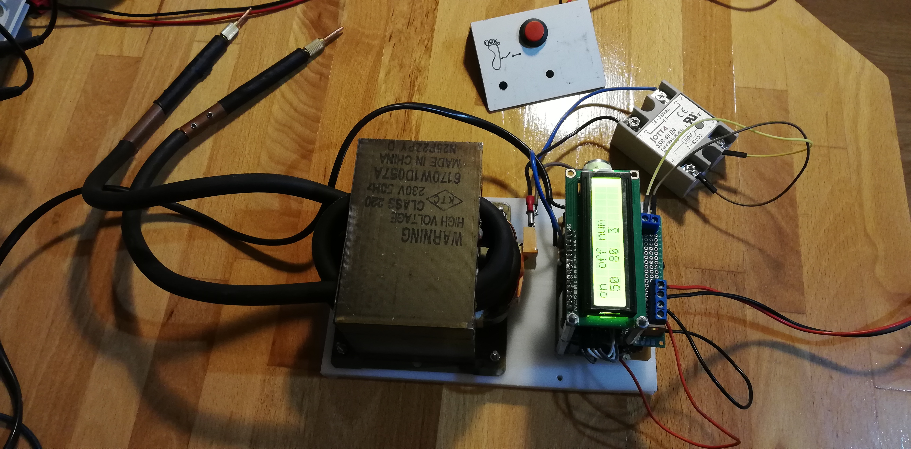

# ESP32 DIY Spot Welder Controller




A precision pulse controller for building a spot welder from a microwave oven transformer (MOT). Features configurable timing, safety controls, and an intuitive rotary encoder interface.

## ⚡ What It Does

Converts a dangerous MOT into a safe, controllable spot welder for battery tab welding, metalworking projects, and electronics repair. The ESP32 generates precise current pulses while the solid-state relay handles the high-power switching safely.

## 🎯 Key Features

- **Configurable pulse timing** - Adjust ON/OFF duration and pulse count via rotary encoder
- **Safety-critical design** - Software-controlled SSR prevents accidental activation
- **Real-time feedback** - 16x2 LCD shows current settings and pulse count
- **Precise control** - Microsecond-level timing for consistent welds
- **Easy interface** - Rotary encoder for parameter adjustment without recompilation

## 🔧 Hardware Requirements

- ESP32 development board
- 16x2 I2C LCD display (HD44780-compatible)
- Rotary encoder
- Solid state relay (SSR) rated for mains voltage
- Microwave oven transformer (MOT)
- Foot pedal or momentary switch (trigger)
- Power supply (3.3V/5V for ESP32, mains for MOT)

**⚠️ Safety Warning:** MOTs output extremely high current (1000+ amps). Improper construction can be lethal. Only attempt if you understand high-voltage/high-current safety practices.

## 📐 Circuit Diagram

Schematics available in `/kicad` directory. Key connections:
- ESP32 GPIO → SSR control input
- SSR output → MOT primary winding
- Rotary encoder → ESP32 GPIO (with debouncing)
- LCD → ESP32 I2C bus
- Trigger switch → ESP32 GPIO (with pull-up)

## 🚀 Building & Flashing

### Prerequisites
- ESP-IDF v4.x or later
- Git

### Clone with submodules
```bash
git clone --recursive https://github.com/spasoye/esp32_spot_welder.git
cd esp32_spot_welder/firmware
```

### Build and flash (choose one method)

**Using idf.py (recommended):**
```bash
idf.py build
idf.py -p /dev/ttyUSB0 flash monitor
```

**Using legacy make:**
```bash
make all -j8
make flash
```

## 🎮 Operation

1. **Power on** - LCD displays current pulse settings
2. **Adjust parameters** using rotary encoder:
   - Pulse ON time (milliseconds)
   - Pulse OFF time (milliseconds)  
   - Number of pulses (1-10)
3. **Press trigger** (foot pedal/switch) - LED indicates welding in progress
4. **Release trigger** - System returns to idle state

## 📊 Technical Highlights

- **ESP-IDF framework** - Professional-grade embedded development
- **Hardware timer control** - Precise pulse generation independent of task scheduling
- **Interrupt-driven encoder** - Responsive UI without polling overhead
- **I2C LCD library** - Clean abstraction using [esp32-i2c-lcd1602](https://github.com/DavidAntliff/esp32-i2c-lcd1602)
- **State machine design** - Safe mode transitions prevent accidental activation

## 📝 Configuration

Edit `main/config.h` to customize:
- GPIO pin assignments
- Default pulse parameters
- LCD I2C address
- Encoder sensitivity

## 🔗 Dependencies

- [esp32-i2c-lcd1602](https://github.com/DavidAntliff/esp32-i2c-lcd1602) - LCD display driver (included as submodule)


See [CHANGELOG.md](CHANGELOG.md) for version history.

## ⚠️ Disclaimer

This project involves high voltage and high current electricity. The author assumes no responsibility for injury, death, or property damage resulting from construction or use of this device. Build at your own risk.

## 📄 License

MIT License - See LICENSE file for details

---

**Built by Ivan Spasić** | [Portfolio](https://spas-tech.hr) | [GitHub](https://github.com/spasoye)